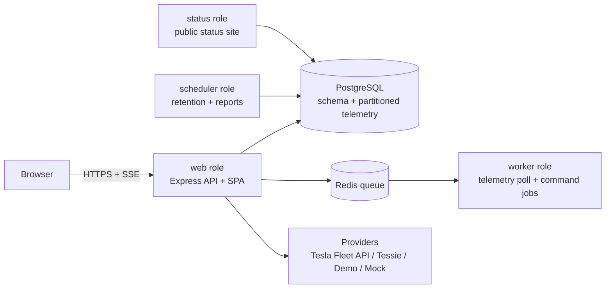

# VoltLink

**Self-hosted connected-vehicle platform** — telemetry, secure vehicle controls, drives & charging analytics, battery health, automations, notifications, fleet management, and a full status platform. One Docker Compose file, your own server, your data.

VoltLink is an original platform (comparable in scope to hosted telematics products) designed to run on a VPS or home server behind PostgreSQL and Redis. It talks to vehicles through a provider framework: the official Tesla Fleet API, the optional Tessie service, a deterministic DemoProvider for trying every feature without a car, and a scriptable MockProvider for tests.

## Feature overview

| Area                | What you get                                                                                                                                                                     |
| ------------------- | -------------------------------------------------------------------------------------------------------------------------------------------------------------------------------- |
| **Telemetry**       | Live vehicle state (lock, doors, trunk/frunk, charge, climate, location), sleep-aware polling, telemetry history in partitioned tables                                           |
| **Controls**        | Command lifecycle `queued → submitted → accepted → confirmed` with `failed/rejected/unsupported/timed_out/canceled` outcomes, high-risk step-up auth, kill switches, rate limits |
| **Drives**          | Auto-detected drives with route maps and replay, totals, CSV/JSON export                                                                                                         |
| **Charging**        | Sessions, electricity cost rules (flat, time-of-use, per-location), manual cost edits                                                                                            |
| **Battery**         | Health estimate, efficiency, charging behavior analytics                                                                                                                         |
| **Automations**     | Trigger + condition + action rules (notify, webhook, incident, report, vehicle command), cooldowns, dry-run, execution history                                                   |
| **Notifications**   | 8 channels: in-app, email, web push, custom webhook + ntfy, Gotify, Discord, Teams; per-channel preferences                                                                      |
| **Fleet**           | Groups, drivers, departments, cost centers, assignments, maintenance records, fleet report                                                                                       |
| **Status platform** | Public status page (`/status`), RSS, SVG badge, subscriptions, incidents + maintenance windows, 16 monitored components                                                          |
| **Security**        | Argon2id passwords, TOTP 2FA, WebAuthn passkeys, session revocation, envelope-encrypted credentials, CSRF, rate limits                                                           |
| **3D showroom**     | Blender-generated GLB vehicles (5 distinct classes, LOD variants) rendered state-aware in WebGL with a procedural fallback                                                       |
| **Privacy**         | Privacy zones that redact addresses in history, configurable retention, full export and permanent deletion                                                                       |
| **Demo mode**       | One click on the Providers page seeds 5 fictional vehicles with 30 days of realistic drives, charges, automations and status content                                             |

## Quick start

The single install guide is [docs/DOCKER_COMPOSE.md](docs/DOCKER_COMPOSE.md).
The short version (pulls the published image, never builds — everything the
stack needs is already inside the compose file, **no `.env` file**) is the
same commands, marked so CI's compose acceptance also runs them:

<!-- run: quick-get-files -->

```bash
curl -fsSL https://raw.githubusercontent.com/Atvriders/voltlink/v1.1.2/docker-compose.yml -o docker-compose.yml
curl -fsSL https://raw.githubusercontent.com/Atvriders/voltlink/v1.1.2/compose.production.yml -o compose.production.yml
```

<!-- run: quick-up -->

```bash
docker compose up -d --wait
```

<!-- run: quick-token -->

```bash
docker compose logs web | grep 'first-run setup token' | tail -1 | awk '{print $NF}'
```

Open http://localhost:3110/setup, paste the token and create the instance
administrator. Enable demo mode on the Providers page to try every feature
without a car. Building from source is a development overlay
(`docker-compose.build.yml`), never an install step.

`docker compose up` pulls `ghcr.io/atvriders/voltlink` — the exact image the
GitHub Actions CI pipeline builds, verifies and publishes (the compose file
never builds anything; pin `VOLTLINK_IMAGE_DIGEST` to the CI-verified digest
for immutable deployments). Requires Docker Compose v2.20+. The in-file
defaults are local-trial quality (web on `127.0.0.1:3110`, published default
secrets) — run the guarded rotation in the guide before exposing the stack to
anything but localhost.

## The API

The web role serves the REST API (and the SPA) at the same base URL —
`http://localhost:3110/api/v1` locally. Machine-readable spec:
[docs/openapi.json](docs/openapi.json) (also served at `/api/docs`) and the
full reference is [docs/API.md](docs/API.md). Getting started:

```bash
# Is it up? (roles report healthy)
curl -fsS http://localhost:3110/healthz

# First-run state; returns needsSetup until the instance admin exists
curl -fsS http://localhost:3110/api/v1/auth/setup-status

# Mutating requests need the CSRF header. This returns {"data":{"token":…}}
# and sets the session-cookie jar; use the token as the x-vl-csrf header:
curl -fsSc /tmp/vl.jar http://localhost:3110/api/v1/auth/csrf

# Sign in (PUT the token from the previous call into x-vl-csrf):
curl -fsS -b /tmp/vl.jar \
  -H 'content-type: application/json' \
  -H 'x-vl-csrf: <token from /auth/csrf>' \
  -d '{"email":"you@example.invalid","password":"your-password"}' \
  http://localhost:3110/api/v1/auth/login

# Authenticated example — list your vehicles (the SPA adds both automatically)
curl -fsS -b /tmp/vl.jar http://localhost:3110/api/v1/vehicles
```

Auth is a `vl_session` cookie plus an `X-VL-CSRF` header on mutating requests.
See [docs/API.md](docs/API.md) for the full route tables.

## Architecture



Monorepo layout:

```
apps/api       Express 5 + Prisma + PostgreSQL (web/worker/scheduler/status roles)
apps/web       React 19 + Vite 7 SPA (5 themes, WebGL showroom, MapLibre map)
packages/shared Domain contracts shared by API and SPA
blender/       Headless Blender pipeline → original vehicle GLB assets
docs/          Full documentation suite
tests/e2e/     Playwright acceptance + WebGL asset tests
```

## Documentation

|                                                                                                                                                                                       |                     |
| ------------------------------------------------------------------------------------------------------------------------------------------------------------------------------------- | ------------------- |
| [Quick start](docs/QUICK_START.md) · [Installation](docs/INSTALLATION.md) · [Docker Compose](docs/DOCKER_COMPOSE.md) · [Configuration](docs/CONFIGURATION.md)                         | Getting running     |
| [Providers](docs/PROVIDERS.md) · [Tesla setup](docs/TESLA_SETUP.md) · [Tessie provider](docs/OPTIONAL_TESSIE_PROVIDER.md) · [Demo mode](docs/DEMO_MODE.md)                            | Connecting vehicles |
| [Vehicle controls](docs/VEHICLE_CONTROLS.md) · [Automations](docs/AUTOMATIONS.md) · [Notifications](docs/NOTIFICATIONS.md)                                                            | Everyday features   |
| [Fleet management](docs/FLEET_MANAGEMENT.md) · [Status page](docs/STATUS_PAGE.md) · [Presentation mode](docs/PRESENTATION_MODE.md)                                                    | Operations          |
| [Security](docs/SECURITY.md) · [Privacy](docs/PRIVACY.md)                                                                                                                             | Trust               |
| [API reference](docs/API.md) · [OpenAPI spec](docs/openapi.json)                                                                                                                      | Developers          |
| [Backup & restore](docs/BACKUP_RESTORE.md) · [Upgrading](docs/UPGRADING.md) · [Troubleshooting](docs/TROUBLESHOOTING.md) · [Deployment](docs/DEPLOYMENT.md)                           | Operations          |
| [Development](docs/DEVELOPMENT.md) · [Testing](docs/TESTING.md) · [WebGL viewer](docs/WEBGL.md) · [Blender assets](docs/BLENDER_ASSETS.md) · [Asset licenses](docs/ASSET_LICENSES.md) | Contributing        |
| [Known limitations](docs/KNOWN_LIMITATIONS.md) · [Changelog](CHANGELOG.md)                                                                                                            | Reference           |

## License

MIT — see [LICENSE.md](LICENSE.md). The Blender-generated vehicle assets are original works created for this project (see [docs/ASSET_LICENSES.md](docs/ASSET_LICENSES.md)).
